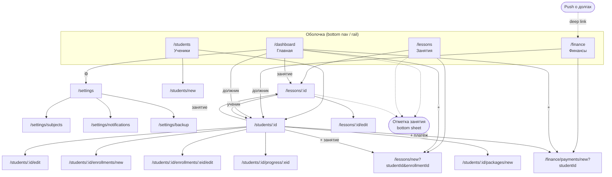

# TutorApp — требования и пользовательские сценарии

Приложение для репетитора, ведущего индивидуальные занятия онлайн.

## Ограничения и решения

| Тема | Решение |
|---|---|
| Пользователи | Один пользователь (преподаватель), без авторизации и блокировки |
| Платформы | Android, Linux |
| Хранение | Только локально (Drift/SQLite), без синхронизации |
| Язык / валюта | Русский и английский (язык системы или выбор в настройках); валюта — только рубли, формат по языку |
| Занятия | Только индивидуальные, создаются вручную (без повторяющихся правил) |
| Предметы | Ученик может заниматься несколькими предметами, у каждого своя ставка |
| Оплата | За каждое занятие и пакетами; платит сам ученик переводом на карту, преподаватель отмечает платежи вручную |
| Прогресс | Шкала оценок задаётся для каждого ученика; тема занятия — свободный ввод |
| Напоминания | Локальные push-уведомления преподавателю о задолженностях |

Решения, помеченные ⚙️, приняты по умолчанию и могут быть пересмотрены.

## 0. Предметная модель и правила

**Сущности:**
- **Ученик**: имя, телефон, Telegram, заметка, шкала оценок, признак архива.
- **Предмет**: справочник предметов, которые ведёт преподаватель.
- **Направление**: пара «ученик × предмет». Хранит ставку за занятие и длительность по умолчанию. Занятия, пакеты и прогресс привязаны к направлению.
- **Занятие**: направление, дата и время, длительность, тема, статус, стоимость, заметка, оценка.
- **Пакет**: направление, число занятий, цена, дата.
- **Платёж**: ученик, сумма, дата, способ ⚙️ (по умолчанию «перевод на карту»), комментарий.

**Статусы занятия:** запланировано, проведено, отменено учеником, отменено преподавателем, пропуск (не пришёл).

**Правила начисления:**
1. Занятие начисляется к оплате в статусах «проведено», «отменено учеником» и «пропуск».
2. Если у направления есть пакет с остатком, занятие списывается из него (сначала из самого старого), и деньги не начисляются. Иначе начисляется стоимость занятия: по умолчанию это ставка направления, но её можно изменить в конкретном занятии.
3. ⚙️ Покупка пакета — это начисление на сумму пакета. Оплата отмечается отдельным платежом, поэтому пакет может быть выдан, но ещё не оплачен.
4. **Баланс ученика** = сумма платежей − сумма начислений. Минус означает долг, плюс — аванс. Баланс один на ученика по всем предметам, но в отчёте его можно разложить по направлениям.
5. Если статус занятия меняется с платного на бесплатный, начисление или занятие из пакета возвращается.
6. ⚙️ **Шкала оценок** ученика задаётся диапазоном. Пресеты: 2–5, 1–10, 0–100 %, а также свой диапазон «мин–макс».
7. Деньги хранятся в копейках, отображаются в рублях.

## 1. User Stories

Все истории от лица преподавателя. **[MVP]** — нужно в первой версии, **[+]** — можно позже.

### Ученик
| ID | Хочу… | чтобы… |
|---|---|---|
| S1 [MVP] | добавить ученика (имя, телефон, Telegram, заметка, шкала оценок) | вести базу учеников |
| S2 [MVP] | добавить ученику одно или несколько направлений (предмет, ставка, длительность по умолчанию) | учитывать разные ставки по предметам |
| S3 [MVP] | видеть список учеников с поиском и балансом каждого | быстро найти нужного и сразу видеть должников |
| S4 [MVP] | открыть карточку ученика: направления, ближайшее занятие, баланс, историю | иметь полную картину по ученику |
| S5 [MVP] | редактировать ученика и направления, менять ставку | ставка менялась только для новых занятий, а старые сохраняли свою стоимость |
| S6 [MVP] | архивировать ученика, а не удалять | история и статистика сохранились |
| S7 [+] | позвонить или открыть Telegram из карточки в одно касание | быстро связаться |
| S8 [MVP] | вести справочник предметов | не вводить название предмета каждый раз заново |

### Занятие
| ID | Хочу… | чтобы… |
|---|---|---|
| L1 [MVP] | создать занятие: ученик → направление, дата и время, длительность (подставляется из направления) | планировать расписание |
| L2 [MVP] | видеть занятия по дням с фильтром по ученику и статусу | ориентироваться в расписании |
| L3 [MVP] | быстро отметить итог занятия: статус, тема, оценка, заметка | фиксировать проведённое за несколько секунд |
| L4 [MVP] | чтобы при отметке приложение само списало занятие из пакета или начислило его стоимость | не считать долги вручную |
| L5 [MVP] | изменить стоимость конкретного занятия | учесть скидку или особую цену |
| L6 [MVP] | редактировать и удалять занятие с корректным пересчётом баланса | исправлять ошибки |
| L7 [MVP] | видеть прошедшие занятия, которые всё ещё в статусе «запланировано» | не забыть их отметить |
| L8 [+] | скопировать занятие на следующую неделю | быстрее планировать (повторяющихся правил по-прежнему нет) |

### Платёж и пакет
| ID | Хочу… | чтобы… |
|---|---|---|
| P1 [MVP] | отметить платёж: ученик, сумма, дата, комментарий | учитывать поступления |
| P2 [MVP] | видеть баланс ученика: начислено, оплачено, долг или аванс | знать, сколько он должен |
| P3 [MVP] | видеть историю ученика: платежи и начисления в одной ленте | разбираться в спорных ситуациях |
| P4 [MVP] | оформить пакет (направление, N занятий, цена) | работать по предоплате |
| P5 [MVP] | видеть остаток занятий в активных пакетах | знать, когда предложить новый пакет |
| P6 [MVP] | редактировать и удалять платёж | исправлять ошибки |
| P7 [MVP] | видеть общий список должников с суммами | контролировать задолженности |
| P8 [MVP] | получать push-уведомление о должниках | не забывать напомнить ученику |
| P9 [MVP] | настраивать напоминания: включены или нет, время, минимальная сумма долга | не получать лишний шум |
| P10 [+] | уведомление, когда в пакете осталось одно занятие | вовремя предложить продление |
| P11 [+] | скопировать готовый текст напоминания о долге | быстро отправить его ученику самому |

### Прогресс
| ID | Хочу… | чтобы… |
|---|---|---|
| G1 [MVP] | ставить оценку за занятие по шкале ученика | фиксировать успеваемость |
| G2 [MVP] | видеть по направлению хронологию: дата, тема, оценка, заметка | помнить, что уже пройдено |
| G3 [MVP] | видеть график оценок и средний балл по направлению | видеть динамику |
| G4 [MVP] | вести общую заметку по направлению (цели, слабые места) | готовиться к занятиям |
| G5 [+] | искать по темам среди занятий ученика | найти, когда проходили конкретную тему |

### Дашборд
| ID | Хочу… | чтобы… |
|---|---|---|
| D1 [MVP] | видеть занятия на сегодня и завтра | знать план |
| D2 [MVP] | видеть неотмеченные прошедшие занятия с быстрой отметкой | держать учёт в актуальном состоянии |
| D3 [MVP] | видеть общую сумму долгов и топ должников | контролировать деньги |
| D4 [MVP] | видеть статистику за месяц: проведено занятий и часов, начислено, получено | понимать нагрузку и доход |
| D5 [+] | переключать период статистики (неделя, месяц, произвольный) | анализировать динамику |

### Настройки и данные
| ID | Хочу… | чтобы… |
|---|---|---|
| A1 [MVP] | экспортировать и импортировать резервную копию базы в файл | не потерять данные (хранение только локальное) |
| A2 [+] | выбрать светлую, тёмную или системную тему | работать с комфортом |

## 2. Экраны

**Основные разделы** (нижняя навигация на Android, NavigationRail на Linux):

| # | Экран | Содержимое |
|---|---|---|
| 1 | **Главная (дашборд)** | Блоки: «Сегодня/завтра», «Нужно отметить», «Долги» (итог + топ-5), «Статистика за месяц». Кнопка «+» для быстрого создания занятия или платежа |
| 2 | **Ученики** | Список: имя, предметы, баланс (красный, если долг). Поиск, фильтры «Все / Должники / Архив». Кнопка «+ ученик» |
| 3 | **Занятия** | Лента по дням с переключателем недели, фильтры по ученику и статусу, цветной индикатор статуса. Кнопка «+ занятие» |
| 4 | **Финансы** | Сводка (долги всего, получено за месяц), вкладки «Должники» и «Платежи», кнопка «+ платёж» |

**Вложенные экраны:**

| # | Экран | Содержимое |
|---|---|---|
| 5 | **Карточка ученика** | Шапка (контакты, баланс). Вкладки: **Обзор** (направления со ставками, активные пакеты, ближайшие занятия), **Занятия**, **Финансы** (общая лента платежей и начислений), **Прогресс** (список направлений) |
| 6 | **Форма ученика** | Имя, телефон, Telegram, заметка, шкала оценок (пресет или свой диапазон) |
| 7 | **Форма направления** | Предмет (из справочника или новый), ставка, длительность по умолчанию, заметка |
| 8 | **Прогресс направления** | График оценок, средний балл, хронология «дата / тема / оценка / заметка», общая заметка |
| 9 | **Форма занятия** | Ученик → направление, дата, время, длительность, стоимость (подставляется из ставки) |
| 10 | **Детали занятия** | Вся информация, статус, тема, оценка, заметка, как занятие оплачено (пакет или начисление). Кнопки «Изменить» и «Удалить» |
| 11 | **Отметка занятия** (bottom sheet) | Статус (chips), тема, оценка по шкале ученика, заметка. Открывается с дашборда, из ленты занятий и из деталей занятия |
| 12 | **Форма платежа** | Ученик, сумма (с подсказкой текущего долга), дата, способ, комментарий |
| 13 | **Форма пакета** | Направление, количество занятий, цена (подставляется: ставка × N), дата |
| 14 | **Настройки** | Разделы: Предметы, Уведомления, Резервная копия, О приложении |
| 15 | **Предметы** | Справочник: добавление, переименование, удаление (только неиспользуемых) |
| 16 | **Уведомления** | Переключатель, время проверки, минимальная сумма долга |
| 17 | **Резервная копия** | Экспорт и импорт файла базы с предупреждением о перезаписи данных |

Настройки открываются иконкой в AppBar дашборда, а не отдельной вкладкой, чтобы в нижней навигации было 4 пункта.

## 3. Карта навигации

**Реализация в go_router:**
- 4 вкладки — это `StatefulShellRoute.indexedStack`, у каждой вкладки свой стек, состояние сохраняется при переключении.
- Формы и детали открываются поверх оболочки, кроме карточки ученика: она внутри вкладки «Ученики».
- Отметка занятия — модальное окно, а не маршрут.
- Нажатие на push-уведомление ведёт на `/finance`.
